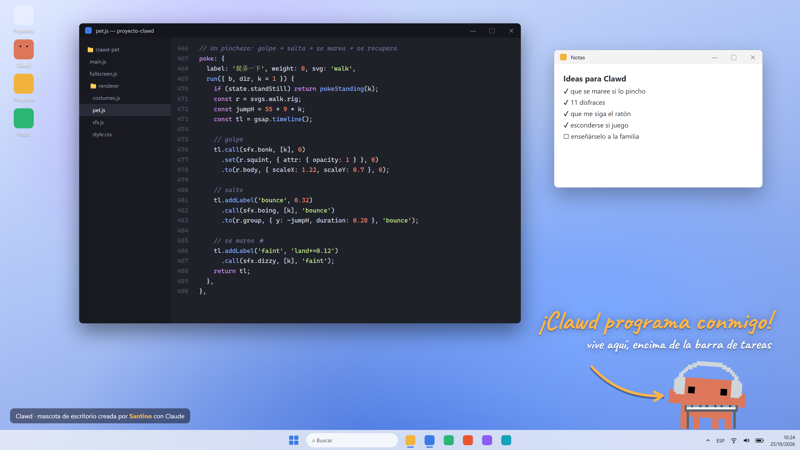
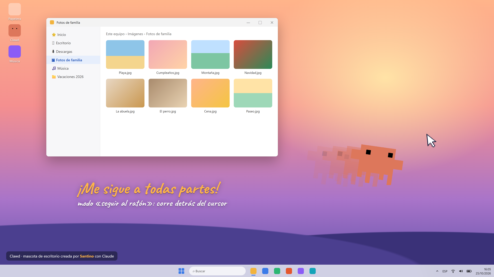
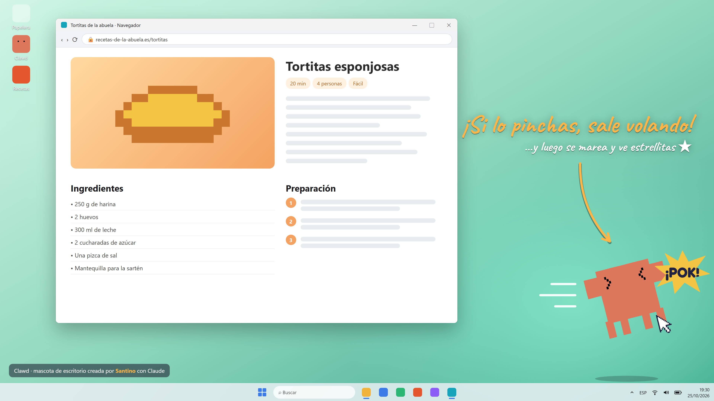
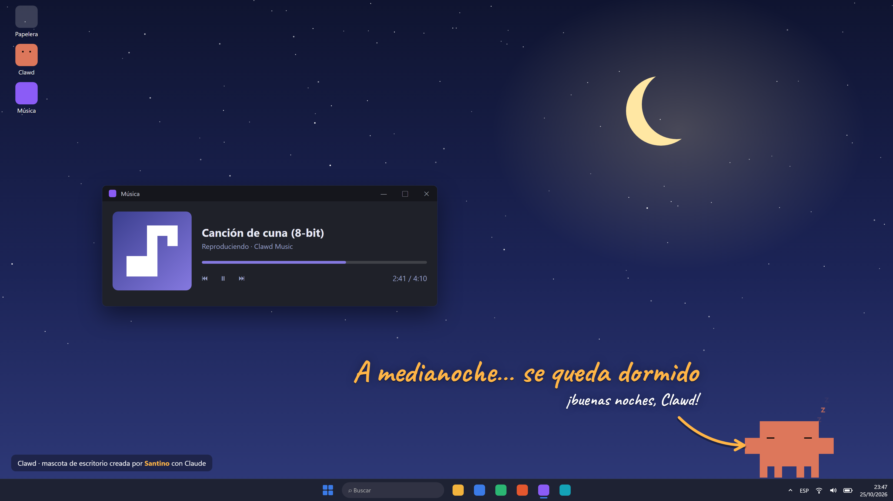
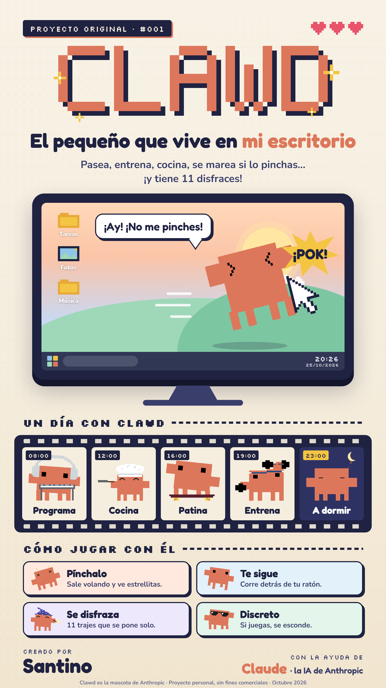
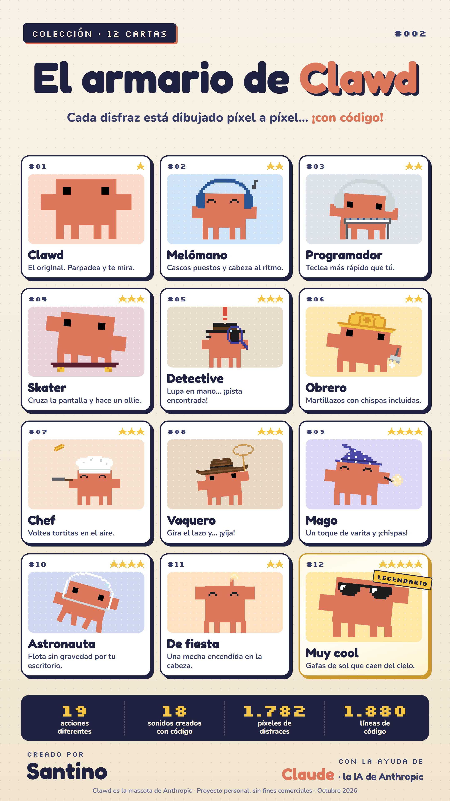

# Clawd · mascota de escritorio

**El pequeño que vive en mi escritorio.** Clawd es una mascota pixelada que vive encima de la barra de tareas de Windows: pasea, hace ejercicio, cocina, se disfraza, te sigue el ratón… y si lo pinchas, sale volando y se marea.

Creado por **Santino**, con la ayuda de **Claude** (la IA de Anthropic).



## Descargar y jugar (Windows)

1. Ve a [**Releases**](https://github.com/GUOCHENN/clawd-pet/releases/latest) y descarga `Clawd-win32-x64.zip`.
2. Descomprímelo donde quieras.
3. Abre `Clawd.exe`. Clawd aparece abajo a la derecha, encima de la barra de tareas.

No hace falta instalar nada más. El icono de Clawd en la bandeja del sistema sirve para traerlo de vuelta o cerrarlo.

> Windows puede avisar de que la aplicación no está firmada: pulsa «Más información» → «Ejecutar de todas formas».

## Qué sabe hacer

| | |
|---|---|
| **Pínchalo** | Recibe el golpe, sale volando, se marea con estrellitas y se recupera. Cuantas más veces seguidas, más alto salta. |
| **Arrástralo** | Lo llevas a cualquier sitio y patalea en el aire. |
| **Te sigue** | Con «seguir al ratón» activado, corre detrás del cursor por toda la pantalla. |
| **Discreto** | Si juegas o ves un vídeo a pantalla completa, se esconde solo y no hace ruido. |
| **Firmes** | Opción «aguantar el golpe»: se queda quieto cuando lo pinchas. |
| **19 acciones** | Pasear, saltar, mirar alrededor, confeti, bandera, gimnasio, dormir… |
| **11 disfraces** | Melómano, programador, skater, detective, obrero, chef, vaquero, mago, astronauta, de fiesta y muy cool. |
| **18 sonidos** | Todos generados con código en tiempo real: ni un solo archivo de audio. |

Todo se controla con **clic derecho** sobre Clawd. (Por ahora el menú está en chino.)

## Galería

| | |
|---|---|
|  |  |
|  | |

| | |
|---|---|
|  |  |

## Para desarrolladores

Hecho con [Electron](https://www.electronjs.org/) y [GSAP](https://gsap.com/). El personaje está dibujado solo con rectángulos SVG; los disfraces son dibujos en texto (ASCII) que el código convierte en píxeles.

```bash
npm install
npm start          # ejecutar
npm run package    # crear Clawd.exe en ../clawd-dist
```

- `main.js`: ventana transparente, bandeja, menú, detección de pantalla completa (`fullscreen.js`).
- `renderer/pet.js`: el esqueleto de Clawd, todas las acciones y la interacción.
- `renderer/costumes.js`: los 11 disfraces.
- `renderer/sfx.js`: los sonidos (Web Audio).
- `showcase/`: el código de los carteles y capturas de esta página.

Documentación detallada (en chino): [docs/README.zh-CN.md](docs/README.zh-CN.md)

## Créditos y avisos

- **Clawd** es la mascota de [Anthropic](https://www.anthropic.com/). Este es un proyecto de fans, personal y sin fines comerciales; no está afiliado a Anthropic.
- Las animaciones de confeti, bandera y gimnasio (`assets/raw/`) y los tiempos de varias animaciones vienen de la recreación de **Ayotomiwa Wale-Durojaye**: [Reverse-Engineering Claude AI’s Mascot Animations with SVG and GSAP](https://tympanus.net/codrops/2026/05/05/reverse-engineering-claude-ais-mascot-animations-with-svg-and-gsap/) (Codrops) y [ayotomcs.me/claude-mascot](https://ayotomcs.me/claude-mascot). Todo el mérito de esos dibujos es suyo.
- La cuadrícula oficial de 12×8 píxeles se tomó como referencia de [ClawdMoji](https://github.com/afspies/clawdmoji).
- Si eres autor de alguno de estos materiales y prefieres que no estén aquí, abre un *issue* y los retiraremos.

---

### 中文简介

Clawd 是一只住在 Windows 任务栏上的像素桌宠：会散步、健身、做饭、换装，会跟着鼠标跑，被戳了会飞起来、晕倒冒星星。全屏玩游戏时会自动躲起来。由 Santino 和 Claude 一起制作。下载请到 [Releases](https://github.com/GUOCHENN/clawd-pet/releases/latest)，详细开发文档见 [docs/README.zh-CN.md](docs/README.zh-CN.md)。
